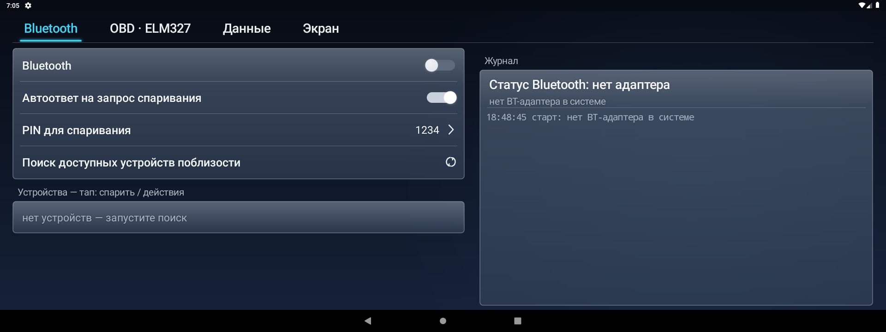
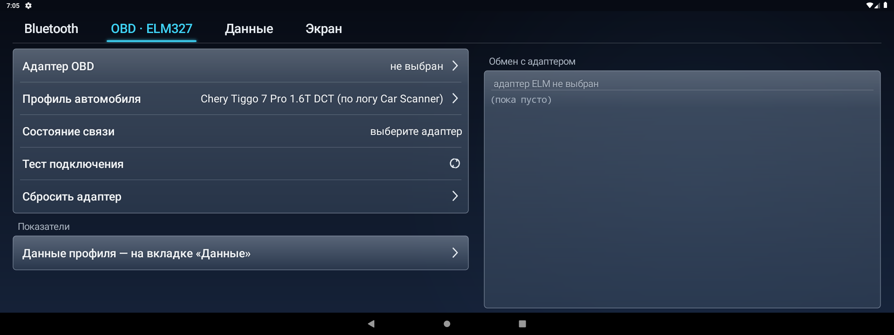
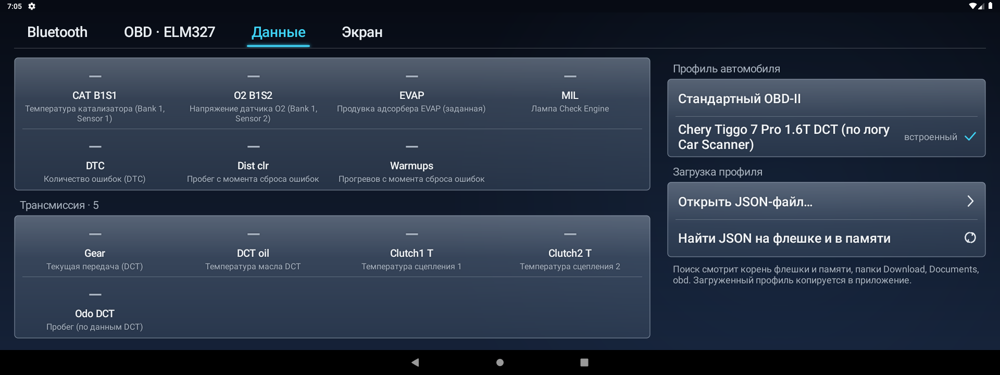
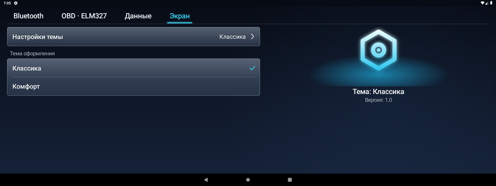

# bt_manager — Bluetooth + OBD-диагностика для ГУ Chery Tiggo

Приложение под горизонтальный головной экран автомобиля (1920×720, Android 9 / API 28),
оформленное как настройки самого ГУ («Классика» и «Комфорт»). Меняет внешний вид
вместе с темой: панели, переключатели, иконостас — всё нарисовано кодом, без ресурсов.

## Вкладки

| Вкладка | Что умеет |
|---|---|
| **Bluetooth** | питание адаптера, скан и спаривание (с автоответом PIN), список спаренных/найденных, выбор адаптера OBD, журнал после |
| **OBD · ELM327** | выбранный адаптер и профиль, состояние связи, сетка показателей, обмен «команда → ответ» с адаптером |
| **Данные** | JSON-профили автомобиля: загрузка (`Открыть JSON…` / поиск на флешке), выбор, все величины по группам |
| **Экран** | тема оформления («Классика», «Комфорт») и версия |

## Скриншоты (1920×720)

<p align="center">
  
  
  
  
</p>


## Собрать

```bash
./gradlew assembleRelease   # app/build/outputs/apk/release/bt_manager-release.apk
./gradlew test              # парсер OBD-ответов и профилей
```

Требуется JDK 21 (Gradle 9.3.1 + AGP 9.1.1). APK подписан `keystore/debug.keystore`
из репозитория: локальная и CI-сборки дают одинаковую подпись и ставятся поверх друг друга.

## CI

`.github/workflows/build.yml`: каждый пуш в `main` — сборка + тесты, APK в артефактах
прогона. Пуш тега `v*` (например `git tag v1.1 && git push --tags`) — то же самое **плюс**
GitHub Release с прикреплённым APK.

## Профили JSON

Приложение опрашивает адаптер ELM327 по JDK-профилю автомобиля — JSON-файлу
(полная схема в [ObdProfile.kt](app/src/main/java/com/dash/btmanager/obd/ObdProfile.kt)
и примерах ниже): какие команды слать, какому блоку (CAN-заголовок `header`,
фильтр ответа `response_header`) и как пересчитать байты в величину (`formula`
с переменными `A, B, C…` и операторами `+ - * / % & | ^ << >>`).

- `samples/chery_tiggo_from_log.json` — Chery Tiggo 7/8 Pro, Omoda C5 (+DCT):
  собран по фактическим ответам из `obd code/obd_log.txt` (Car Scanner), значения
  формул сверены с логом; заводские DID с непроверенной семантикой честно помечены.
- `samples/standard_obd.json` — эталон стандартного OBD-II (режимы 01/09) без
  заголовков и протокола: работает на любом авто с ELM327.
- `assets/profiles/` — встроенные профили (видны в списке сразу).

Загрузить: вкладка «Данные» → «Открыть JSON-файл…» либо «Найти JSON на флешке
и в памяти» — поиск пятню корни накопителей, папки `Download`, `Documents`, `obd`
и `profiles` (файл до 2 МБ). Без профиля опрашивается стандартный набор OBD-II.

## Структура

```
app/src/main/java/com/dash/btmanager/
  bt/            BtManager — питание, скан, спаривание (PIN), SPP-тест
  obd/           ELM327: ElmHub (связь/цикл), ObdParser (ответы), ObdProfile
                 + Formula (формулы байт), ProfileStore (JSON-профили)
  ui/            MainActivity — вёрстка экрана кодом; theme/ — панели,
                 переключатели, темы, фоновый градиент
samples/         примеры профилей (см. выше)
keystore/        debug.keystore — подпись release для CI
```

## Замечания

- `targetSdk = 28` — намеренно: ГУ работает на Android 9 и без разрешений
  `BLUETOOTH_SCAN/CONNECT` из Android 12; приложение для сайдлоада, требования Play нет.
- Скан устройств требует геопозицию (на Android 9 так отдают результаты скана).
- Масштаб интерфейса — константа `DashTheme.SCALE` (тек. 1.15).
- Формулы завода-специфичных DID частично «не сверено» — всё помечено в `note` профиля.
